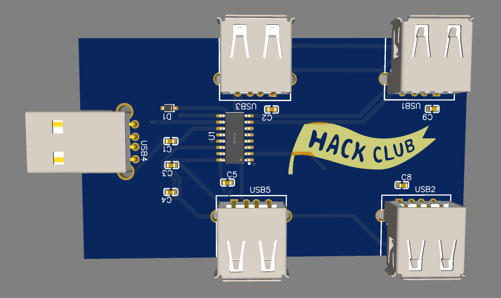
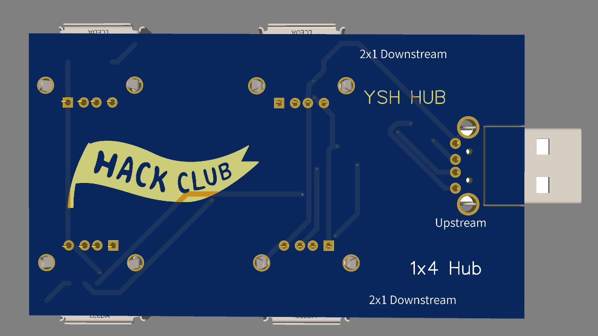
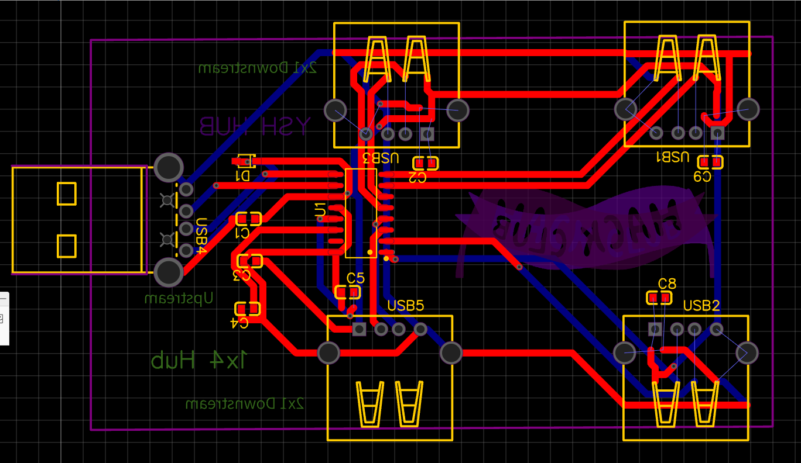
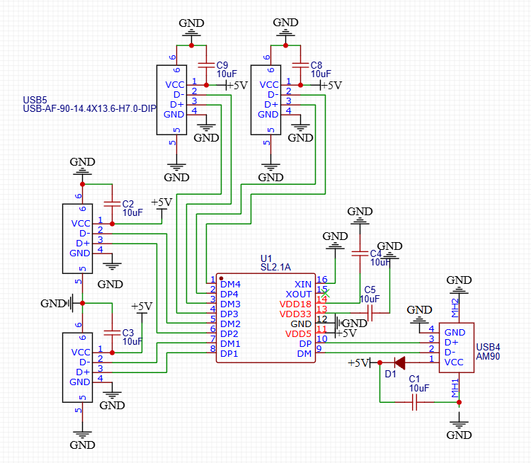
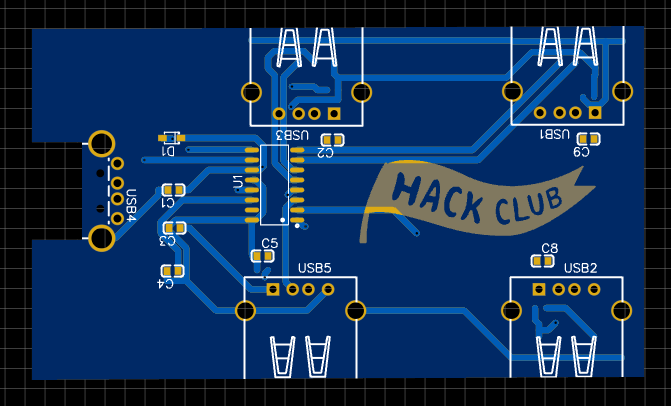

# YSH HUB

YSH HUB is my attempt at making my own open PCB USB HUB. :D
The idea is simple: 1 doenstream to 4 upstreams - usb hub ! 
I'm making the Hub from scratch in EasyEDA, so this project is also a way for me to learn more about PCB design and power supply.

## Project Files

- SCH_YSH-Hub_2026-11-04.json [SCH](./SCH_YSH-Hub_2026-11-04.json) — Schematic
- PCB_PCB_YSH-Hub_2026-11-04.json [PCB](./PCB_PCB_YSH-Hub_2026-11-04.json) — PCB design

## Build using 

- EasyEDA Standard Online 
- Jams/Hacker-Card for initial start of 2 downstreams 
- 

## Status

The initial schematic and PCB design are ready. The next step is to review the design, get the PCB made, and test it.
On Screen is Completed ! 

## Links

- [Forge Project](https://forge.hackclub.com/projects/4486)

## BOM 
[BMO](./BMO_YSH-Hub_2026-11-04.csv)
